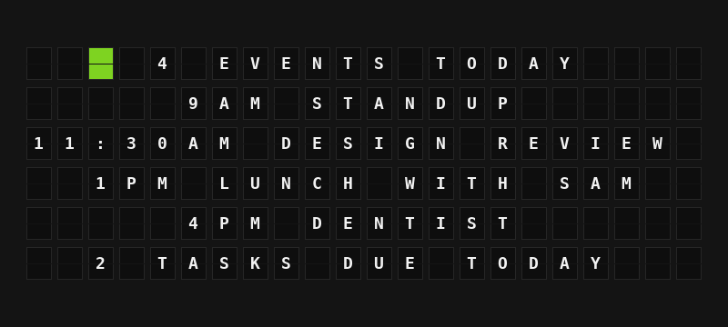

# Google Calendar & Tasks Plugin

Show today's agenda, what's happening now, what's next, and the tasks due today from your Google account.



**→ [Setup Guide](./docs/SETUP.md)**

## Overview

The Google Calendar & Tasks plugin reads your Google Calendar and Google Tasks and turns them into board-ready variables: a count of today's events, each event with its start time, whether you're in a meeting right now, the next event to start (up to a week ahead), and the tasks due today.

You sign in once with FiestaBoard's **Sign in with Google** button, using a free OAuth client that you create in your own Google Cloud project (the plugin's settings walk you through it). FiestaBoard keeps the sign-in fresh. The plugin can only read: it can't add, change or delete events or tasks. Requires FiestaBoard 9.8.0 or later (see [Connecting Accounts](https://fiestaboard.app/docs/features/connecting-accounts)).

## Template Variables

### Today

| Variable | Description | Example |
|----------|-------------|---------|
| `{{google_calendar.date_label}}` | Today's date | `FRI OCT 2` |
| `{{google_calendar.headline}}` | `4 EVENTS TODAY`, `1 EVENT TODAY` or `NO EVENTS TODAY` | `4 EVENTS TODAY` |
| `{{google_calendar.event_count}}` | Events today, all-day ones included | `4` |
| `{{google_calendar.events_left}}` | Events today that haven't ended | `2` |
| `{{google_calendar.all_day_count}}` | All-day events today | `1` |
| `{{google_calendar.events.0.title}}` | Title of today's event 0-9 (all-day events first, then by start time) | `STANDUP` |
| `{{google_calendar.events.0.time}}` | Its start time, or `ALL DAY` | `9AM` |
| `{{google_calendar.events.0.end_time}}` | Its end time (empty for all-day events) | `9:15AM` |
| `{{google_calendar.events.0.line}}` | Start time and title on one line (just the title for all-day events) | `9AM STANDUP` |
| `{{google_calendar.events.0.location}}` | Its location | `ROOM 4B` |

### Right Now

| Variable | Description | Example |
|----------|-------------|---------|
| `{{google_calendar.is_busy}}` | A timed event is happening now (events shown as Free don't count) | `true` |
| `{{google_calendar.busy_tile}}` | One colour tile: red while busy, green while free | `{66}` |
| `{{google_calendar.now_title}}` | The event happening now | `DESIGN REVIEW` |
| `{{google_calendar.now_until}}` | When it ends (`UNTIL SAT` if it runs past midnight) | `UNTIL 12:30PM` |

### Next Event

| Variable | Description | Example |
|----------|-------------|---------|
| `{{google_calendar.next_title}}` | The next event to start, within a week | `DESIGN REVIEW` |
| `{{google_calendar.next_time}}` | Its start time, or `ALL DAY` | `11:30AM` |
| `{{google_calendar.next_day}}` | `TODAY`, `TOMORROW` or a date | `TODAY` |
| `{{google_calendar.next_in}}` | How soon it starts | `IN 25M` |
| `{{google_calendar.next_location}}` | Its location | `ROOM 4B` |
| `{{google_calendar.next_line}}` | Start time and title on one line | `11:30AM DESIGN REVIEW` |

`next_in` reads `IN 25M`, `IN 1H 30M`, `IN 14H` or `IN 2D`. Times are as of the last refresh.

### Tasks

| Variable | Description | Example |
|----------|-------------|---------|
| `{{google_calendar.tasks_due_count}}` | Open tasks due today | `2` |
| `{{google_calendar.tasks_overdue_count}}` | Open tasks due before today (with **Include Overdue Tasks**) | `1` |
| `{{google_calendar.tasks_line}}` | `2 TASKS DUE TODAY`, `1 TASK DUE TODAY` or `NO TASKS DUE` | `2 TASKS DUE TODAY` |
| `{{google_calendar.next_task}}` | First task due | `WATER THE PLANTS` |
| `{{google_calendar.tasks.0.title}}` | Title of task 0-9 | `WATER THE PLANTS` |
| `{{google_calendar.tasks.0.list}}` | The task list it's on | `MY TASKS` |
| `{{google_calendar.tasks.0.overdue}}` | Whether it's past due | `false` |

All text is in capitals, accents are folded (`CAFE`), and characters the board can't show are dropped.

## Example Templates

Today's agenda (Flagship, center-aligned, the demo page):

```jinja
{{google_calendar.busy_tile}} {{google_calendar.headline}}
{{google_calendar.events.0.line}}
{{google_calendar.events.1.line}}
{{google_calendar.events.2.line}}
{{google_calendar.events.3.line}}
{{google_calendar.tasks_line}}
```

Next event (Note, left-aligned):

```jinja
NEXT {{google_calendar.next_in}}
{{google_calendar.next_title}}
{{google_calendar.next_time}} {{google_calendar.next_day}}
```

Busy now (Flagship, center-aligned):

```jinja
{{google_calendar.busy_tile}} {{google_calendar.now_title}}
{{google_calendar.now_until}}

NEXT
{{google_calendar.next_line}}
{{google_calendar.next_in}}
```

## Configuration

| Setting | Type | Required | Default | Description |
|---------|------|----------|---------|-------------|
| `enabled` | boolean | No | `false` | Turn the plugin on |
| `client_id` | string | To sign in | | Client ID of your own Google Cloud OAuth client (Web application), ending in `.apps.googleusercontent.com`. Entered in the **Account connection** section |
| `client_secret` | string (password) | To sign in | | Client secret of the same OAuth client. Entered in **Account connection** |
| `calendar_ids` | string | No | `primary` | Calendar IDs to show, separated by commas |
| `show_declined` | boolean | No | `false` | Include events you declined |
| `show_all_day` | boolean | No | `true` | Include all-day events |
| `show_tasks` | boolean | No | `true` | Read Google Tasks for the tasks variables |
| `include_overdue` | boolean | No | `false` | Also list open tasks whose due date has passed |
| `time_format` | `12h` or `24h` | No | `12h` | `9:30AM` or `09:30` |
| `timezone` | string | No | FiestaBoard's | Which day counts as today and how times are shown |
| `refresh_seconds` | integer | No | `300` | How often to check Google (60-3600) |

The sign-in itself is not a setting: press **Sign in with Google** in the plugin's **Account connection** section. The manifest's `oauth` block declares Google's endpoints with the relay flow (authorization code with PKCE, plus your client secret, which Google requires for Web application clients), `access_type=offline` and `prompt=consent` so Google issues a refresh token, and these read-only scopes:

| Scope | Used for |
|-------|----------|
| `https://www.googleapis.com/auth/calendar.readonly` | `GET /calendar/v3/calendars/{calendarId}/events` |
| `https://www.googleapis.com/auth/tasks.readonly` | `GET /tasks/v1/users/@me/lists` and `GET /tasks/v1/lists/{tasklist}/tasks` |

No environment variables: the client ID and secret live in the plugin settings because the platform reads them from there. The secret stays on your board and is only sent to Google's token endpoint.

## Features

- Signs in with FiestaBoard's account connection, so it works on a board that lives on your home network. FiestaBoard stores and refreshes the tokens; the plugin asks for the current one on every refresh
- Several calendars merged into one agenda; an event that appears on two of them is shown once
- Recurring events, all-day and multi-day events, and events that run past midnight
- Leaves out cancelled events, Google's working-location entries and, unless you ask, events you declined
- Busy or free right now, with a red or green tile; events marked Free don't count as busy
- The next event up to a week ahead, with how soon it starts
- Google Tasks due today across all your task lists, optionally with overdue ones
- One fetch serves every board: a Flagship and a Note showing the plugin share it. Task lists are looked up once an hour
- Respects `Retry-After` on rate limits and backs off after outages, timeouts and rejected sign-ins instead of retrying on every render. During an outage the board keeps today's last data for up to 30 minutes
- Error messages say what to do: sign in, reconnect after a `401`, enable the Calendar or Tasks API, grant every permission, or fix a calendar ID
- Works on every board shape: Flagship, Note, and Note arrays

## Author

FiestaBoard Team
